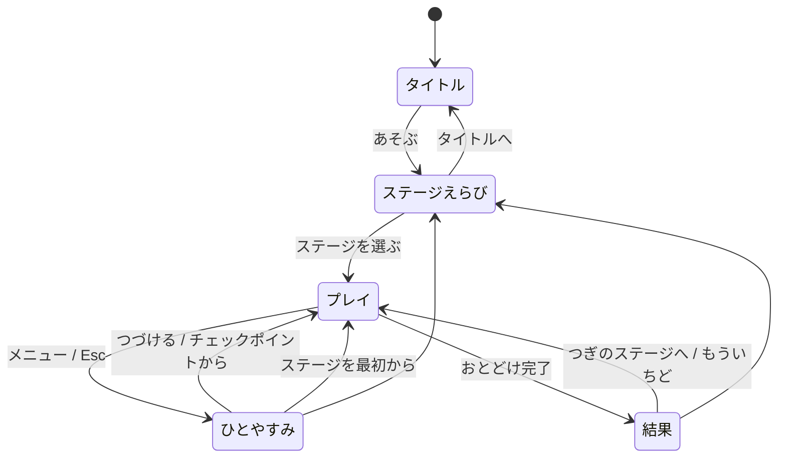
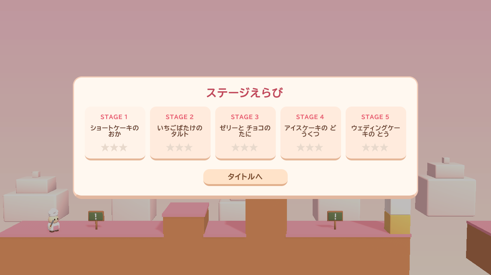
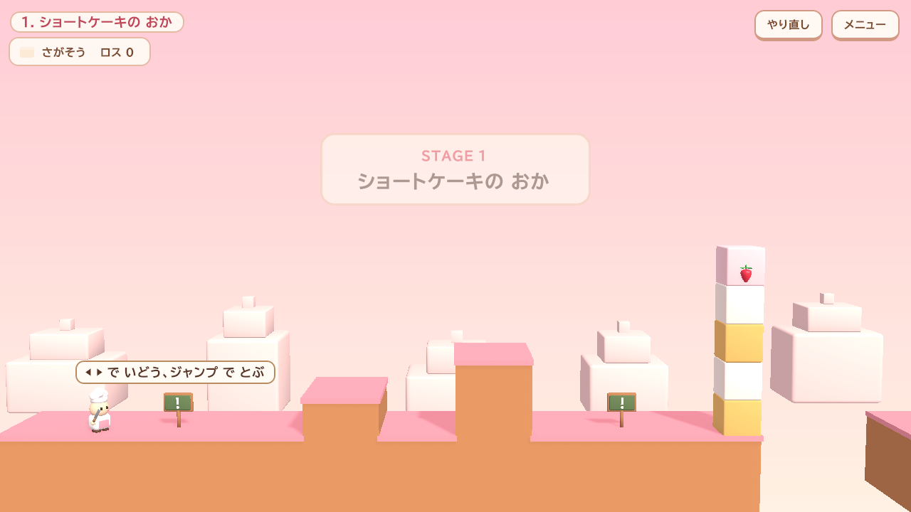
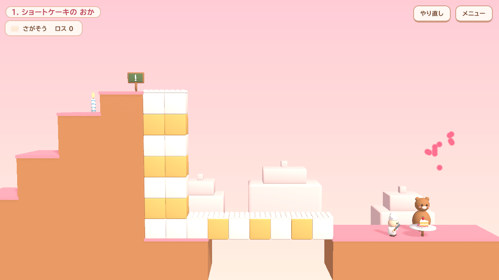
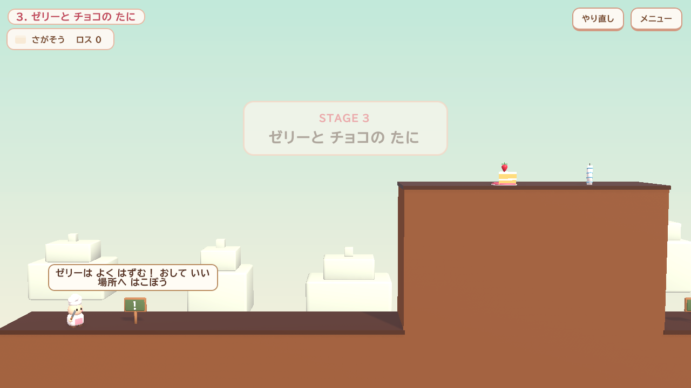
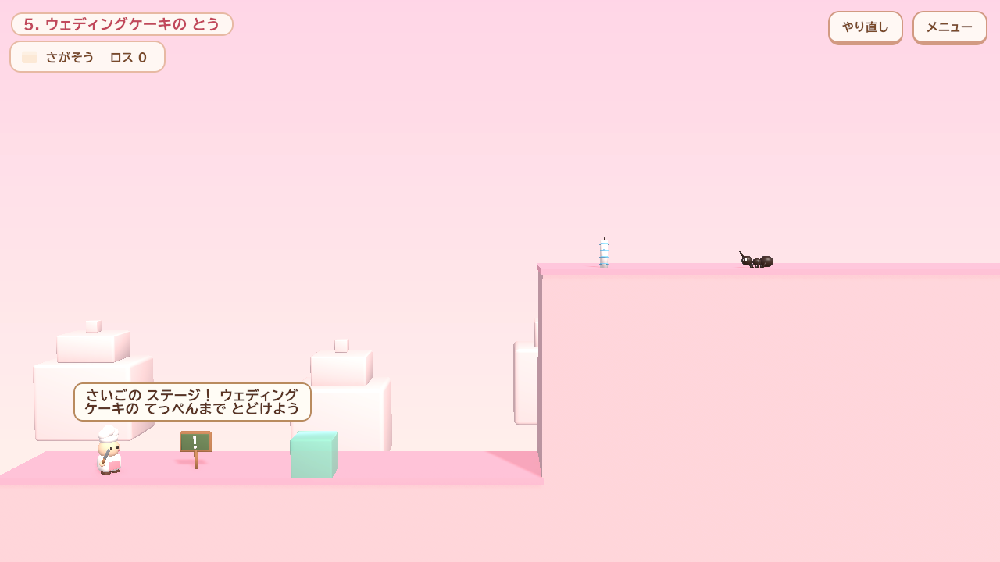
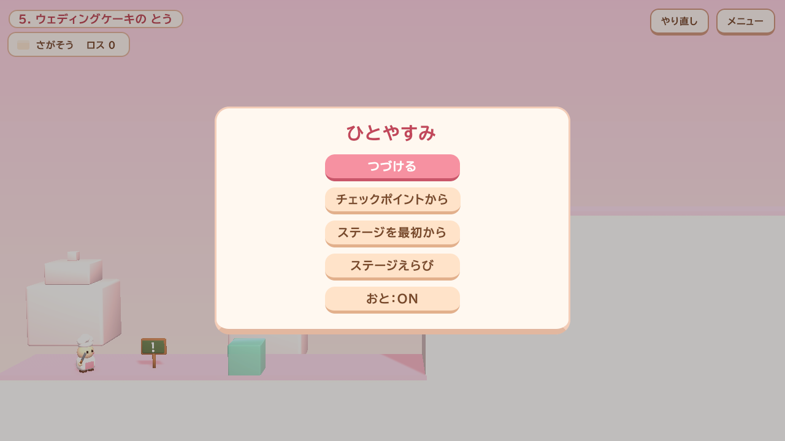

# 01. ゲーム仕様書

## 1. 概要

| 項目 | 内容 |
|---|---|
| タイトル | ピース・オブ・ケーキ（PIECE OF CAKE） |
| キャッチコピー | 朝飯前？ とんでもない。 |
| ジャンル | 横スクロール パズルアクション（2.5D：3D モデルを真横から見る） |
| ステージ数 | 5 |
| 対応入力 | キーボード、ゲームパッド、タッチ（スマホ・タブレット） |
| エンジン | Unity 6（6000.6）+ URP |
| 元になった試作品 | [Reference/prototype.html](Reference/prototype.html)（HTML 版。ルールと数値はこれと完全に同じ） |

小人のパティシエ見習いが巨大なケーキの上を進みます。ケーキを **切る** と足場になり、**食べる** と能力が付きます。ただし、食べたり落としたりしたケーキは「もったいない（ロス）」として評価が下がります。リボン付きの **ごちゅうもんのケーキ** を拾って、ゴールのお客さんに届けるとクリアです。

## 2. 操作

| 操作 | キーボード | ゲームパッド | タッチ |
|---|---|---|---|
| 移動 | ← → / A D | 左スティック / 十字キー | ◀ ▶ ボタン |
| ジャンプ | Space / ↑ / W / Z | A（South） | ジャンプ |
| 切る | X / J | X（West） | 切る |
| 食べる | C / K | Y（North） | 食べる |
| やり直し（チェックポイントから） | R | Select | 画面右上「やり直し」 |
| メニュー（ポーズ） | Esc / P | Start | 画面右上「メニュー」 |

- ジャンプには「コヨーテタイム」（足場を離れて 0.07 秒以内なら跳べる）と「先行入力」（着地 0.12 秒前の入力を受け付ける）があります。
- タッチボタンはモバイル端末で自動表示されます（エディタでは `GameBootstrap.forceTouchControls` で確認可能）。

## 3. ルール

### 3.1 ケーキ（ピース）
ケーキは 1 マス単位の **セル** の集まりで、くっついたセルが 1 つの **ピース** として一緒に動きます。

| セル | 記号 | 足場として | 食べると | 特記 |
|---|---|---|---|---|
| スポンジ | S | 普通 | もぐもぐ | 上が空いていればクリームが乗って見える |
| クリーム | C | 普通 | もぐもぐ | 同上 |
| いちご | B | 普通 | **ジャンプ力アップ**（12 秒、跳躍・走りが強化） | |
| チョコ | K | 普通 | **ちからもち**（12 秒、重いケーキを押せる） | **切れない**（「カチン！」） |
| ゼリー | J | 乗ると **高く跳ねる** | もぐもぐ | |
| アイス | I | 乗ると 0.6 秒で **溶けて消える** | もぐもぐ | 溶けた分はロスにならない |
| ごちゅうもん | O | — | 食べられない | 触れると拾う。必ず 1 マスの単独ピース |

### 3.2 アクション
- **押す**：ケーキに向かって歩き続ける（0.12 秒）と 1 マス動く。上に乗っているケーキも一緒に動く。
  - 重さ（セル数）の上限は 4。チョコパワー中は 12。超えると「おもくて うごかない…」。
  - **幅 1・高さ 2 以上** のケーキは押すと **倒れて横向きの橋** になる（倒れる先が空いているときだけ）。
- **切る**：
  1. 体の前にケーキがあれば、その列の向こう側で縦に切る。
  2. なければ、足もとのケーキを足の先の線で縦に切る。切れた向こう側が幅 1・高さ 2 以上なら、そのまま前へ倒れて橋になる。
  - 切れ目にチョコが含まれると切れない。切っても数は減らない（ロス 0）。
- **食べる**：体の前、なければ足もとのケーキを 1 セル食べる。食べた結果ピースが分かれることがある。ロス +1。
- **重力**：支えのないピースは落ちる。下に別のピースが落下中なら、その上に重なって一緒に落ちる。マップの下へ落ちたピースはロスに加算。

### 3.3 危険
| 危険 | 内容 |
|---|---|
| フォーク（`^`） | 触れるとミス。ケーキは乗れる（足場になる） |
| 落下 | マップの下へ落ちるとミス |
| アリ（`a`） | 横から触れるとミス。上から踏むと倒せる。動いているケーキ（スライド・倒れ・落下）でつぶせる |
| 落ちてくるケーキ | 頭の上に落ちてくるとミス |

- ミスすると 1.2 秒後に最後のチェックポイントから再開（アリも復活）。復活直後 1.5 秒は無敵。
- **ごちゅうもんのケーキがマップ下に落ちた** 場合はミスとは数えず、1.6 秒後にチェックポイントから再開。

### 3.4 チェックポイント
ろうそく（`F`）に触れると火がつき、その時点のケーキ・アリ・ロス数・「ごちゅうもんを持っているか」が保存されます。

### 3.5 クリアと評価
ごちゅうもんのケーキを持ってお客さんに触れると「おとどけ」。1.7 秒の演出後に結果画面になります。

| 評価 | 条件（ロス = 食べた数 + 落とした数） |
|---|---|
| ★★★ | ロス ≦ 目標（par） |
| ★★ | ロス ≦ 目標 + 3 |
| ★ | それ以上 |

ベストの★はステージごとに保存されます（[02_Definitions.md](02_Definitions.md#6-セーブデータ)）。

## 4. ステージ

| # | 名前 | テーマ | 目標ロス | お客さん | 学ぶこと |
|---|---|---|---|---|---|
| 1 | ショートケーキの おか | shortcake | 0 | くま | 押して倒す橋、上で切る橋 |
| 2 | いちごばたけの タルト | tart | 6 | うさぎ | 食べる、いちごパワー、押して踏み台、足もとを食べて降りる |
| 3 | ゼリーと チョコの たに | jellychoco | 2 | ねこ | ゼリーで跳ぶ、チョコパワーで重いケーキを押す、チョコは切れない |
| 4 | アイスケーキの どうくつ | icecave | 0 | ペンギン | アリ、溶けるアイス、低いトンネル |
| 5 | ウェディングケーキの とう | wedding | 4 | おひめさま | 全部の組み合わせ |

全ステージに ★3 の解法があり、自動テストで毎回確認しています（[06_Testing.md](06_Testing.md)）。

## 5. 画面遷移

| 画面 | スクリーンショット |
|---|---|
| タイトル |  |
| ステージえらび |  |
| プレイ（開始時のバナーと看板） |  |
| 押して倒した橋 |  |
| 上で切って倒した橋 |  |
| おとどけ |  |
| 結果 |  |
| ステージ 3 |  |
| ステージ 4 |  |
| ステージ 5 |  |
| ひとやすみ |  |

## 6. HUD

- 左上：ステージ名、ごちゅうもんの所持状態（もってる！／さがそう）、ロス数、パワーアップの残り時間バー。
- 右上：やり直し、メニュー。
- 吹き出し：シェフのセリフ、近くの看板の説明、ゴール付近でお客さんの「ケーキ まだかな？」。
- 開始時にステージ名のバナー、ごちゅうもんを落とすとトースト表示。
