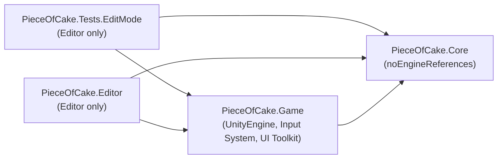

# 03. アーキテクチャ設計書

## 1. 方針

1. **ルールとエンジンを分ける**：ゲームのルールは Unity に依存しない純 C#（`PieceOfCake.Core`）。表示・入力・音・UI は `PieceOfCake.Game`。
2. **決定的（deterministic）なシミュレーション**：1/60 秒固定ステップ、乱数なし、`double` で計算。同じ入力なら必ず同じ結果になり、HTML 試作品とフレーム単位で一致します。
3. **表示は状態から毎フレーム描き直す**：ケーキのセルは GameObject を持たず、GPU インスタンシングでシミュレーション状態を直接描きます。切る・食べる・溶けるで「表示側の後始末」が要りません。
4. **データ駆動**：ステージは JSON、見た目は ScriptableObject（`GameArt`）、文言は `Texts`、音はコードで合成。
5. **再現できるセットアップ**：モデル（Blender スクリプト）、マテリアル、カタログ、シーンはメニューから再生成できます（[07_Operations.md](07_Operations.md)）。

## 2. アセンブリとフォルダ



依存は必ず右向き（Core は何にも依存しない）。`Core` の asmdef は `noEngineReferences: true` なので、UnityEngine を誤って使うとコンパイルエラーになります。

```
Assets/PieceOfCake/
├─ Art/Materials/            URP マテリアル（MaterialLibrary が生成）
├─ Art/Models/               FBX（ArtSource/build_models.py が出力）
├─ Config/GameArt.asset      見た目のカタログ
├─ Data/Levels/levels.json   ステージデータ
├─ Input/GameControls.inputactions
├─ Scenes/Main.unity         唯一のシーン（MainSceneBuilder が生成）
├─ Scripts/
│  ├─ Core/      ルール（Common, Levels, Model, Simulation）
│  ├─ Game/      表示と入出力（App, Audio, Content, Effects, Input, Levels, Persistence, UI, World）
│  └─ Editor/    メニューツール
├─ Tests/EditMode/
└─ UI/           Main.uxml, Main.uss, PanelSettings, RuntimeTheme.tss
ArtSource/       Blender ソース（build_models.py, .blend）
Docs/            このドキュメント
```

## 3. Core（ルール）

| 区分 | クラス | 責務 |
|---|---|---|
| 公開窓口 | `StageSimulation` | 1 ステージの実行。`Step(InputFrame)`、`RetryFromCheckpoint()`、`DrainEvents()`、読み取り専用の状態 |
| データ | `LevelDefinition` → `LevelParser` → `LevelLayout` | 生データ → 検証 → 不変のレイアウト |
| モデル | `Cell` `Piece` `Player` `Ant` `Checkpoint` `RunStats` `StageResult` | 状態。setter は `internal`（外から書き換えられない） |
| 状態 | `StageState` | 実行中の可変状態を 1 か所に集約し、各システムが共有 |
| システム | `PieceSystem` | アニメーション、アイスの溶け、重力 |
| | `PlayerSystem` | 移動・当たり判定・ゼリー/アイス・押す・トゲ |
| | `PlayerActions` | 切る・食べるの判定 |
| | `CakeOperations` | 倒す・押す・切るの規則 |
| | `AntSystem` / `CrushSystem` | アリ、つぶれ判定 |
| | `ProgressSystem` | 拾う・チェックポイント・届ける |
| | `CheckpointService` | 保存と復元 |
| 補助 | `WorldQueries` `OccupancyGrid` `PieceTopology` `GameplayOutcomes` `EventBuffer` | 空間の問い合わせ、占有マップ、連結成分分割、共通の結果処理、イベント |

1 ステップの順序（試作品と同じ）：

```
PieceSystem → PlayerSystem → AntSystem → CrushSystem → ProgressSystem(プレイ中のみ)
→ ごちゅうもん落下タイマー → おとどけタイマー
```

## 4. Game（表示・入出力）

| 区分 | クラス | 責務 |
|---|---|---|
| 起動 | `GameBootstrap` | **唯一の MonoBehaviour**。参照を検証し、全サービスを 1 回だけ組み立てる（Composition Root） |
| 流れ | `GameFlow` | 画面遷移の状態機械。UI イベントと `StageSession` をつなぐ |
| | `StageSession` | 固定ステップ実行（1 フレーム最大 6 ステップ）、イベント配信、表示更新 |
| 世界 | `StageView` | ステージの表示一式を生成・破棄 |
| | `TerrainBuilder` | 地形を 1 メッシュに結合（見えない面は省く） |
| | `CakeRenderer` / `InstanceBatch` | セルを GPU インスタンシングで描画 |
| | `ChefView` `AntViews` `PropViews` `BackgroundView` `CameraRig` | キャラ・小物・背景・カメラ |
| | `WorldMapper` | シミュレーション座標 → ワールド座標 |
| 演出 | `GameEventPresenter` `EffectsPlayer` | イベント → 音・粒子・揺れ |
| 音 | `SfxSynth` `SfxPlayer`（`ISfxPlayer`） | 効果音を起動時に合成、8 ボイスで再生 |
| 入力 | `PlayerControls` ← `IControlSource`（`InputSystemControls`, `TouchControls`） | 端末をまとめ、押下をステップまで保持 |
| UI | `UiRoot` `TitleScreen` `StageSelectScreen` `PauseScreen` `ResultScreen` `ErrorScreen` `HudView` `BubbleLayer` `TouchControlsView` `FontLoader` `Texts` | UI Toolkit |
| データ | `LevelJson` `LevelCatalog` | JSON 読み込みと全ステージの事前検証 |
| 保存 | `IProgressStore` / `PlayerPrefsProgressStore` | ベスト★と消音設定 |
| 見た目 | `GameArt` `ThemeStyle` | メッシュ・マテリアル・プレハブ・テーマ |

## 5. フレームの流れ

```
Update:     PlayerControls.Poll() → GameFlow.Update(dt)
              └ Playing: Pause/Retry 判定 → StageSession.Tick(dt)
                   └ 固定ステップ × n（Step(ConsumeFrame())）→ イベント取り出し → 音・粒子
LateUpdate: GameFlow.Render(dt) → StageView.Render → CameraRig.Follow → HUD → 吹き出し
```

- 入力の「押した」は `PlayerControls` が保持し、次のステップで 1 回だけ使われます（描画フレームとステップのずれで取りこぼさない）。
- フレーム落ち時は 1 フレーム最大 6 ステップ・最大 0.1 秒に制限します（処理が雪だるま式に重くなるのを防ぐ）。

## 6. 開発原則の適用

| 原則 | 適用箇所 |
|---|---|
| **S**（単一責任） | Core のシステムを役割ごとに分割。表示も `TerrainBuilder` / `CakeRenderer` / `ChefView` … と分割。MonoBehaviour は `GameBootstrap` だけ |
| **O**（開放閉鎖） | 新しいお客さん・テーマ・ステージは **データ追加だけ**（`GameArt`, `levels.json`）。新しい演出は `GameEventPresenter` に case を足すだけでルールは不変 |
| **L**（リスコフ置換） | `IControlSource` の実装（キーボード／タッチ）はどれでも同じように扱える |
| **I**（インターフェース分離） | `ISfxPlayer`（Muted, Play だけ）、`IProgressStore`（BestStars, RecordStars, Muted だけ） |
| **D**（依存性逆転） | `GameFlow` は `ISfxPlayer` / `IProgressStore` に依存し、具体実装は `GameBootstrap` が注入 |
| **KISS** | 物理エンジンを使わず格子＋箱の当たり判定。セルは GameObject を作らずインスタンシング。UI は UXML/USS |
| **YAGNI** | ローカライズ基盤・アセットバンドル・ステージエディタ等は作らない（文言は `Texts` に集約済みで、必要時に差し替え可能） |
| **DRY** | 定数は `SimConstants`、パスは `ProjectPaths`、文言は `Texts`、色はマテリアル（粒子色もマテリアルから取得） |

## 7. 主な設計判断

| 判断 | 理由 |
|---|---|
| 物理エンジン（Rigidbody）を使わない | 倒れる・切る・積み重なる動きが不安定になりパズルが成立しないため。試作品と同じ自前の格子判定にした |
| `double` で計算し試作品と同じ式・同じ順序 | 試作品（JavaScript の double）とフレーム単位で一致させ、テストで移植の正しさを保証するため |
| 安定ソート（`OrderByDescending`）を使用 | 落下処理の順番を試作品と一致させるため（`List.Sort` は不安定） |
| UI は UI Toolkit | レイアウトをテキスト（UXML/USS）で管理でき、差分レビューしやすい |
| フォントは OS の日本語フォント | フォントファイルを同梱しない（ライセンス・容量）。見つからない場合は警告（[07_Operations.md](07_Operations.md)） |
| 効果音をコードで合成 | 音声アセット不要、試作品の音と同じレシピ |
