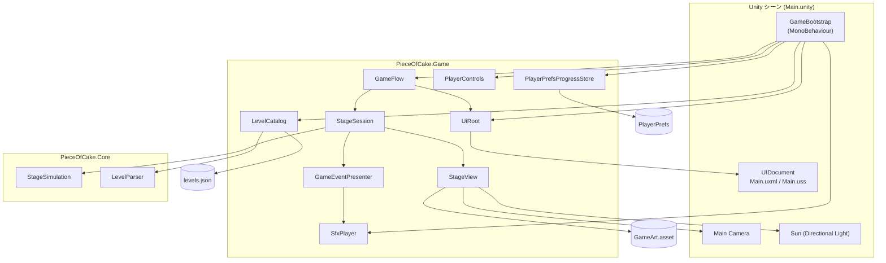
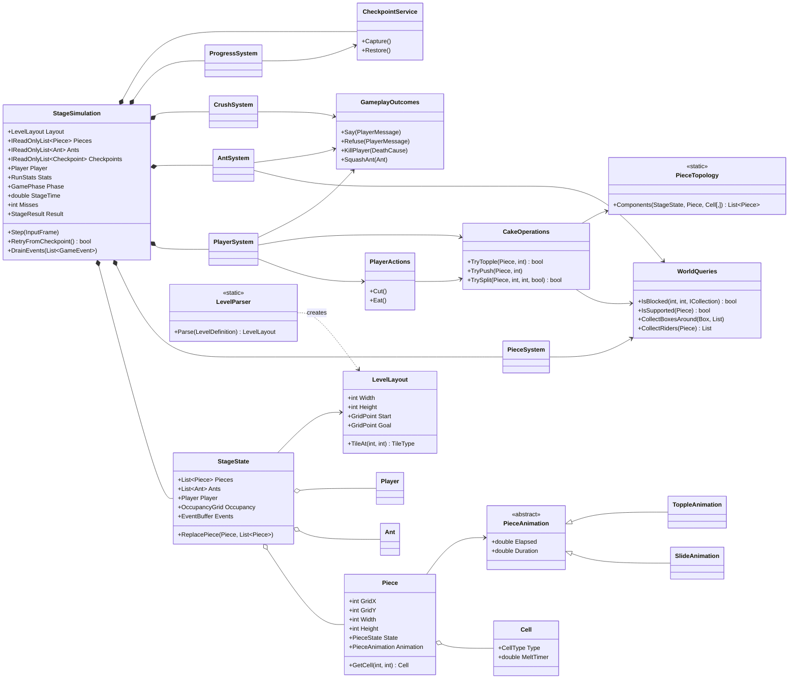
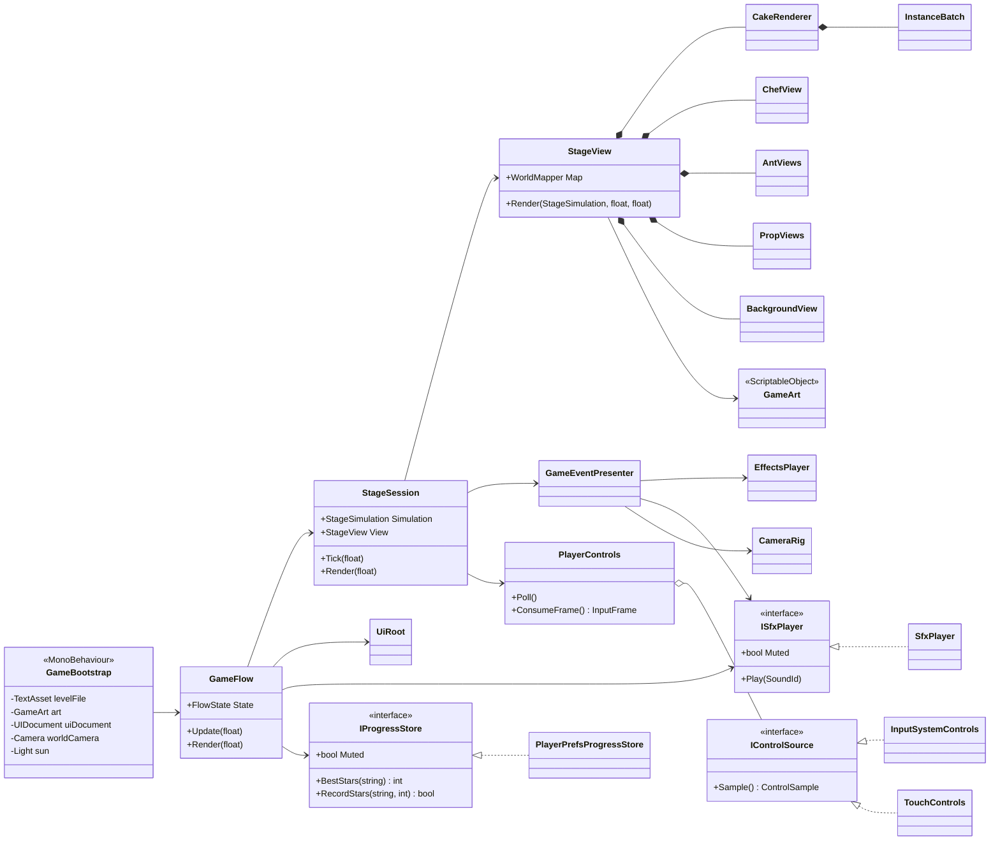
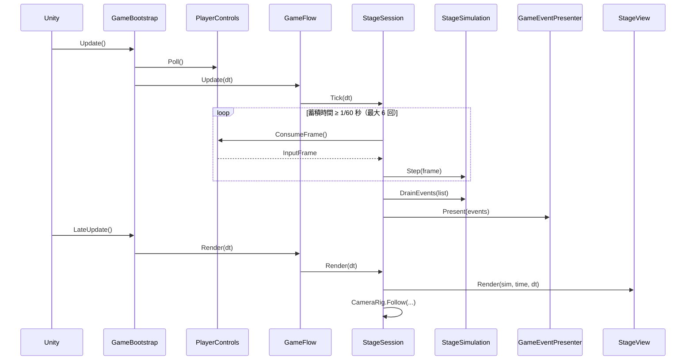
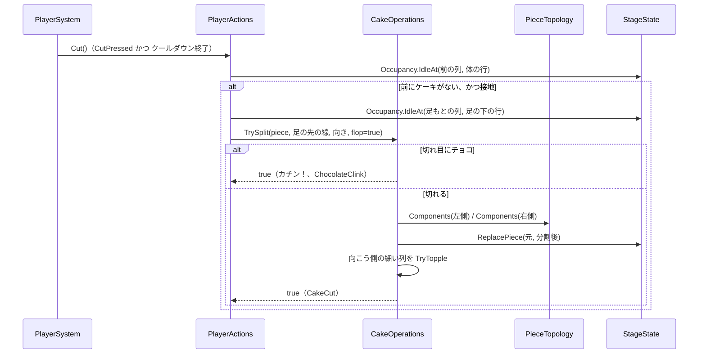
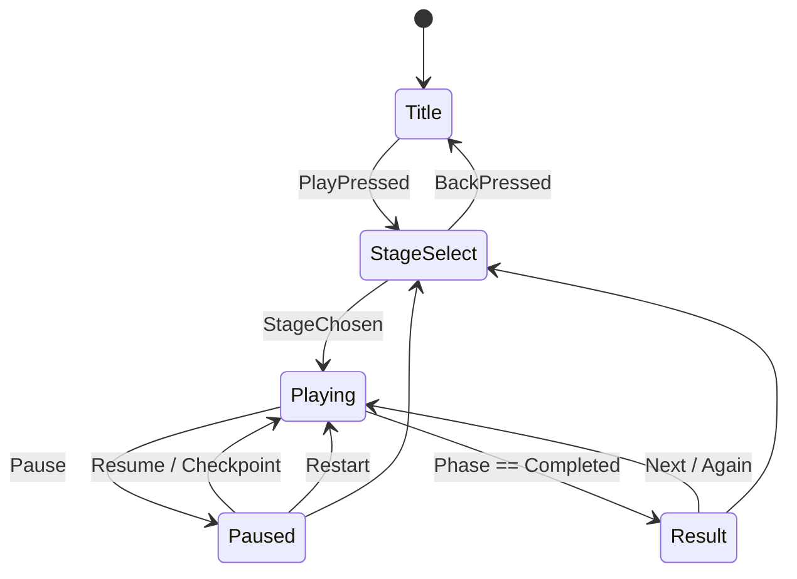
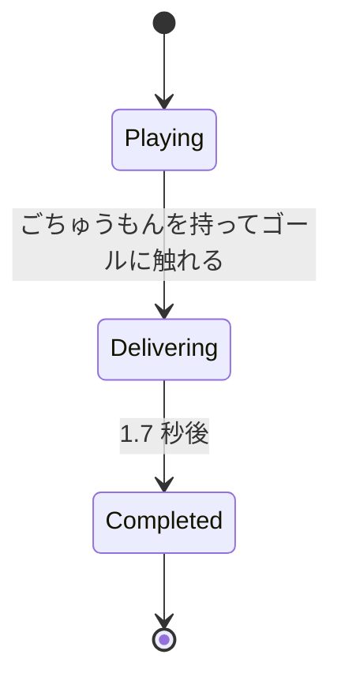
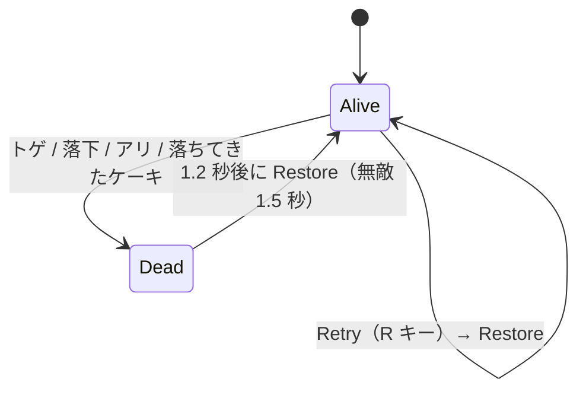
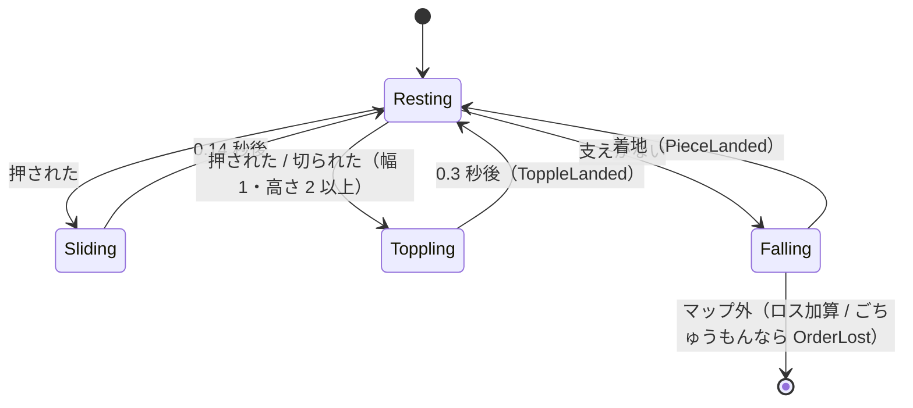

# 04. UML 図

GitHub 上では Mermaid 図がそのまま描画されます。

## 1. コンポーネント図

## 2. クラス図：Core（ルール）

## 3. クラス図：Game（表示と入出力）

## 4. シーケンス図：1 フレームの更新

## 5. シーケンス図：ケーキの上で「切る」

## 6. 状態遷移図

### GameFlow（画面）

### GamePhase（シミュレーション）

### プレイヤーの生死とチェックポイント

### ピース

