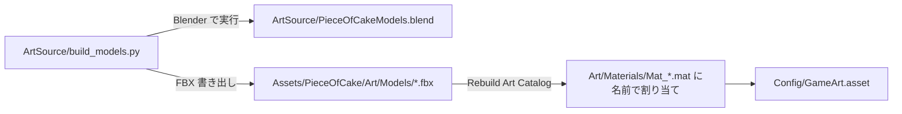

# 08. アート制作パイプライン

## 1. 流れ



モデルはすべて **Python スクリプトから生成** します。形を変えるときは `.blend` を手で編集するのではなく、スクリプトを直して実行し直すのが基本です（差分が追え、誰でも同じ結果になる）。

## 2. 実行方法

Blender の Scripting タブで次を実行します（`<プロジェクトのフォルダ>` は各自の環境のパスに置き換えます）。

```python
path = r"<プロジェクトのフォルダ>\ArtSource\build_models.py"
exec(compile(open(path, encoding="utf-8").read(), path, "exec"), {"__file__": path, "__name__": "__main__"})
```

- 専用シーン `PieceOfCakeModels` の中だけで作業し、他のシーンには触れません。
- 実行後、Unity に戻って **Tools ▸ Piece of Cake ▸ Rebuild Art Catalog** を実行します。

## 3. 規約

| 項目 | 規約 |
|---|---|
| 単位 | 1 Blender 単位 = 1 Unity 単位 = 1 マス |
| 向き（Blender） | X = 右、Z = 上、-Y = 正面（カメラ側） |
| 向き（Unity に取り込んだ後） | Y 軸まわりに 180° 回った状態（正面が +Z）。表示コード側で向きを合わせている |
| 原点 | 底面の中心（`Cell` だけ立方体の中心） |
| マテリアル名 | `Mat_*`。Unity の同名マテリアルに自動で割り当てられる。**色は Unity 側が正** |
| FBX 設定 | Forward = -Z、Up = Y、Apply Transform、Scale = FBX All |

## 4. モデル一覧

| ファイル | 用途 | 構成 |
|---|---|---|
| `Cell.fbx` | ケーキのセル（全種類共通の角を丸めた立方体） | 1 メッシュ |
| `CreamCap.fbx` | セルの上のクリーム | 1 メッシュ |
| `Strawberry.fbx` | いちごセルの飾り | 実・葉の 2 サブメッシュ |
| `OrderSlice.fbx` | ごちゅうもんのケーキ（皿・リボン付き） | 6 サブメッシュ |
| `Chef.fbx` | シェフ | `ChefBody`, `FootL`, `FootR`, `Knife`（原点 = 手。切る動作で回転） |
| `Ant.fbx` | アリ | 1 メッシュ（頭は -X 側に作成） |
| `Customer_*.fbx` | お客さん 5 種（Bear, Rabbit, Cat, Penguin, Princess） | 1 メッシュ |
| `Table.fbx` | ゴールのテーブル | 1 メッシュ |
| `Candle.fbx` | チェックポイント | `CandleBody`, `Flame`（点灯時のみ表示） |
| `Fork.fbx` | トゲ | 1 メッシュ |
| `Sign.fbx` | 看板 | 1 メッシュ |

## 5. モデルを追加するには

1. `build_models.py` に `build_xxx()` を書き、`BUILDERS` に追加して実行。
2. 新しいマテリアル名を使った場合は `MaterialLibrary.Specs` に色を追加。
3. `GameArt` にフィールドを足し、`ArtCatalogBuilder.Fill` で割り当て、表示コードで使う。
4. お客さんを増やす場合は `ArtCatalogBuilder.Customers` に追加するだけで、ステージの `customer` から使えます。
