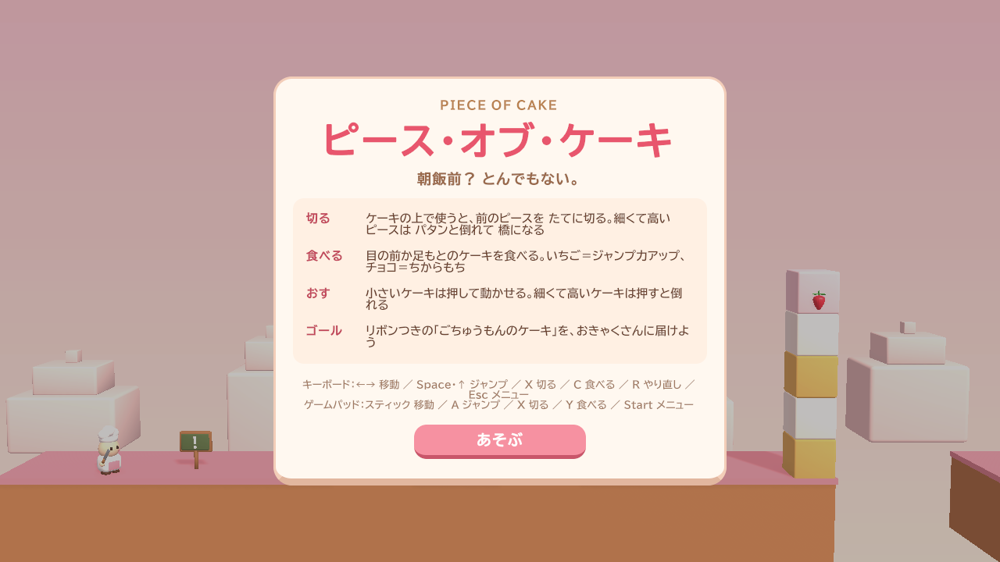
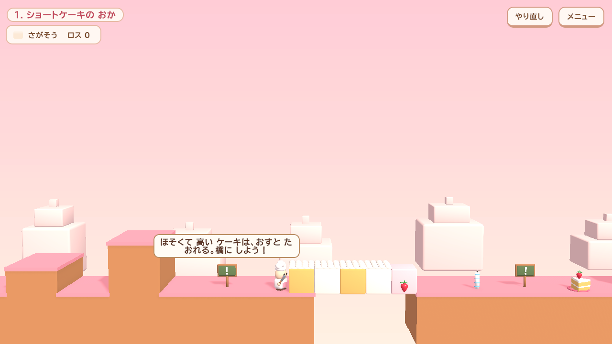
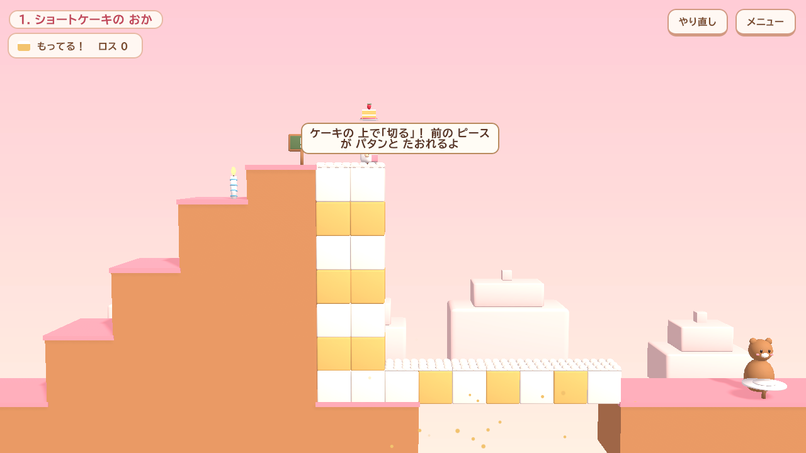
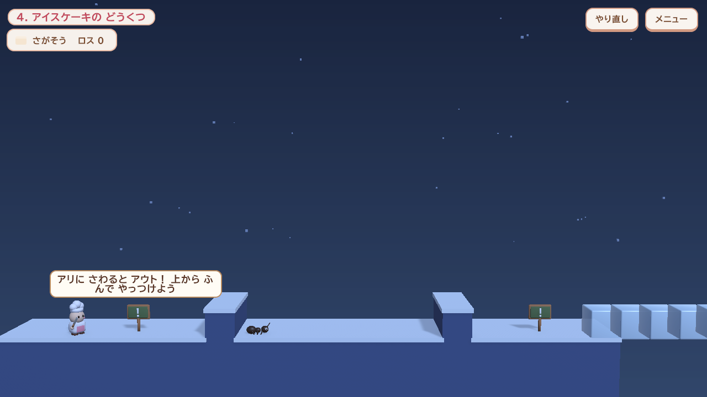
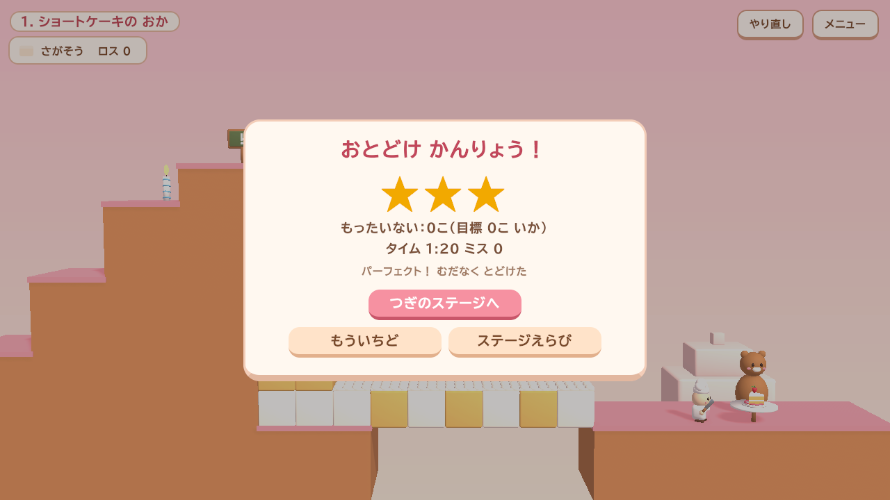

# ピース・オブ・ケーキ（PIECE OF CAKE）

> 朝飯前？ とんでもない。

> **ポートフォリオ作品**（[作品一覧へ](https://github.com/sawai-naoki-portfolio)）。設計資料（仕様書・定義書・設計書・UML・テスト仕様）は [`Docs/`](Docs/README.md) にあります。
>
> | 項目 | 内容 |
> |---|---|
> | 開発 | 個人開発。企画・仕様決め・設計の判断・レビュー・テストでの検証は自分で行い、実装とドキュメント作成には生成 AI（Claude Code）を活用 |
> | 開発時期 | 2026 年 10 月〜11 月（コミットの記録: 2026/10/31〜2026/11/01） |
> | 公開状況 | 未公開 |

小人のパティシエ見習いが巨大なケーキの上を進む、横スクロールのパズルアクションです。ケーキを **切って** 足場にし、**食べて** 能力を得て、リボン付きの「ごちゅうもんのケーキ」をお客さんに届けます。食べたり落としたりするほど評価が下がります。

| | |
|---|---|
|  |  |
|  |  |

## 遊び方

| 操作 | キーボード | ゲームパッド |
|---|---|---|
| 移動 | ← → | 左スティック |
| ジャンプ | Space | A |
| 切る | X | X |
| 食べる | C | Y |
| やり直し / メニュー | R / Esc | Select / Start |

スマホ・タブレットでは画面上のボタンで操作できます。

## 動かし方

1. Unity 6000.6.6f1 でこのフォルダを開く
2. `Assets/PieceOfCake/Scenes/Main.unity` を開いて Play

## 構成

- `Assets/PieceOfCake/Scripts/Core` … ルール（Unity 非依存・決定的。HTML 試作品とフレーム単位で一致）
- `Assets/PieceOfCake/Scripts/Game` … 表示・入力・UI・音
- `Assets/PieceOfCake/Scripts/Editor` … セットアップ用メニュー（Tools ▸ Piece of Cake）
- `Assets/PieceOfCake/Tests/EditMode` … 自動テスト（全 5 ステージの ★3 クリアを含む 53 件。内訳は [テスト仕様](Docs/06_Testing.md)）
- `ArtSource/` … 3D モデルを生成する Blender スクリプト
- `Docs/` … 仕様書・定義書・設計書・UML・運用手順・スクリーンショット（[一覧](Docs/README.md)）
